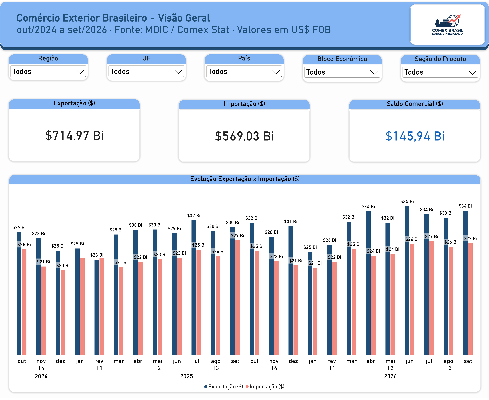
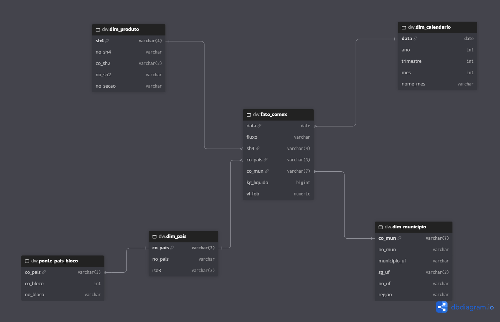
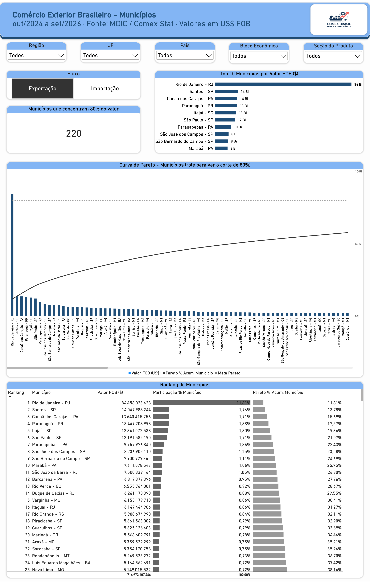
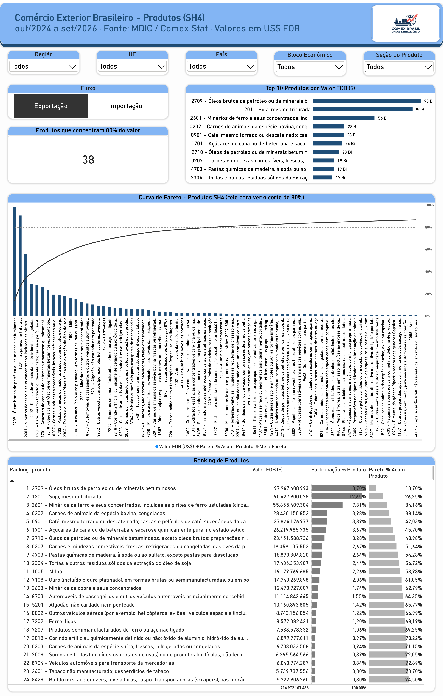
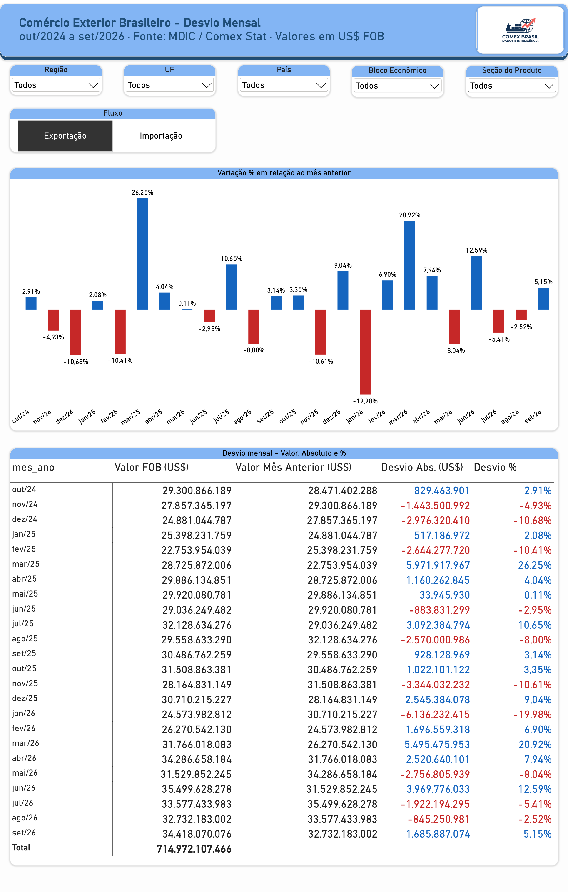
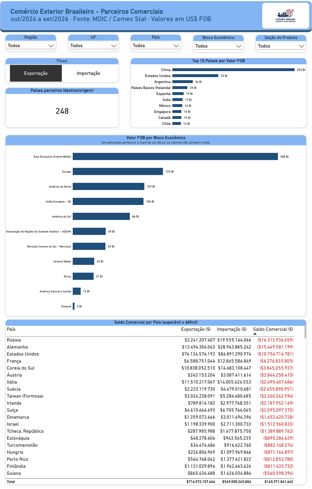

# Comércio Exterior Brasileiro (2024–2026)

   

Dashboard de exportação e importação por município e produto (SH4), de **out/2024 a set/2026**: os 24 meses fechados mais recentes da base do MDIC (Comex Stat). Valores em US$ FOB.

Carreguei 2024 inteiro no PostgreSQL para o cálculo de desvio de out/2024 ter o mês anterior como base, mas os visuais mostram só os 24 meses. Além das análises de município, produto e desvio mensal, incluí uma página de parceiros comerciais (país e bloco econômico).

## Arquitetura e ferramentas

`Arquivos CSV (MDIC)` → `PostgreSQL (schema staging)` → `PostgreSQL (schema dw)` → `Power BI`

No `staging` os CSVs entram como vieram, tudo texto. No `dw` ficam as views com tipos, nomes tratados e o modelo estrela. Usei views para poder mudar regra sem recarregar dado. O Power BI conecta só no `dw`, em modo Importar.

**Ferramentas:** PostgreSQL, DBeaver, dbdiagram.io e Power BI Desktop (Power Query e DAX).

## Fonte e arquivos utilizados

Comex Stat (MDIC): item 2, base por município e SH4, e item 4, tabelas de correlação. Foram 13 arquivos:

| Arquivo | Para que usei | Observação |
|---|---|---|
| `EXP_2024_MUN`, `EXP_2025_MUN`, `EXP_2026_MUN` | Fato de exportação | 3.252.883 linhas no total |
| `IMP_2024_MUN`, `IMP_2025_MUN`, `IMP_2026_MUN` | Fato de importação | 4.903.515 linhas no total |
| `EXP_TOTAIS_CONFERENCIA_MUN`, `IMP_TOTAIS_CONFERENCIA_MUN` | Conferir se a carga estava completa | Trazem os totais oficiais de 1997 a 2026; usei só 2024 a 2026 |
| `NCM_SH` | Nome do produto, SH2 e seção | Está no nível SH6 (6.620 linhas); precisei agrupar para SH4 |
| `UF_MUN` | Nome do município | 5.570 municípios, na mesma codificação da fato |
| `UF` | UF e região | Região vem escrita como "REGIAO NORTE" |
| `PAIS` | Nome do país e código ISO | 281 países |
| `PAIS_BLOCO` | Bloco econômico do país | 324 linhas, 11 blocos |

Fatos e conferência em ASCII; auxiliares em Latin-1.

## Banco de dados: schemas, tabelas e views

O banco se chama `comex` e tem dois schemas.

### Schema `staging` (dados brutos, tudo como `text`)

| Tabela | Colunas | Linhas |
|---|---|---:|
| `staging.exp_mun` | `co_ano, co_mes, sh4, co_pais, sg_uf_mun, co_mun, kg_liquido, vl_fob` | 3.252.883 |
| `staging.imp_mun` | mesmas colunas da exportação | 4.903.515 |
| `staging.exp_conferencia` | `arquivo, co_ano, kg_liquido, vl_fob, numero_linhas` | 30 |
| `staging.imp_conferencia` | mesmas colunas | 30 |
| `staging.ncm_sh_raw` | `linha` (a linha inteira do CSV, sem separar) | 6.620 |
| `staging.ncm_sh` | os 16 campos do NCM_SH separados via SQL + `qtd_campos` | 6.620 |
| `staging.uf_mun` | `co_mun_geo, no_mun, no_mun_min, sg_uf` | 5.570 |
| `staging.uf` | `co_uf, sg_uf, no_uf, no_regiao` | UFs + códigos especiais |
| `staging.pais` | `co_pais, co_pais_ison3, co_pais_isoa3, no_pais, no_pais_ing, no_pais_esp` | 281 |
| `staging.pais_bloco` | `co_pais, co_bloco, no_bloco, no_bloco_ing, no_bloco_esp` | 324 |

### Schema `dw` (views consumidas pelo Power BI)

| View | Colunas | Linhas | Origem |
|---|---|---:|---|
| `dw.fato_comex` | `data, fluxo, sh4, co_pais, co_mun, kg_liquido, vl_fob` | 8.156.398 | `exp_mun UNION ALL imp_mun` |
| `dw.dim_municipio` | `co_mun, no_mun, municipio_uf, sg_uf, no_uf, regiao` | 5.570 | `uf_mun LEFT JOIN uf` |
| `dw.dim_produto` | `sh4, no_sh4, produto, co_sh2, no_sh2, co_secao, no_secao` | 1.274 | `ncm_sh` agrupado por SH4 |
| `dw.dim_pais` | `co_pais, no_pais, iso3` | 281 | `pais` |
| `dw.ponte_pais_bloco` | `co_pais, co_bloco, no_bloco` | 318 | `pais_bloco` sem os códigos órfãos |

A `dim_calendario` foi feita em DAX no Power BI, marcada como tabela de data.

## Modelo de dados

Granularidade da fato: uma linha por mês, fluxo, SH4, país e município. Exportação e importação ficam na mesma fato, separadas pela coluna `fluxo`.

53 países estão em mais de um bloco (ex.: Alemanha em Europa e UE). Por isso o bloco fica numa tabela ponte ligada à `dim_pais` e não na fato, senão os valores duplicariam. A ponte é a única relação bidirecional no Power BI, para o filtro de bloco chegar até a fato (testei com "União Europeia": a exportação foi de US$ 715 bi para US$ 106 bi).

## Problemas encontrados e tratamentos

Nenhum valor da fato foi alterado ou excluído.

- **NCM_SH com aspas sem escape** no meio do texto, o que quebrava o `COPY`. Carreguei a linha inteira e separei os campos por `";"` em SQL; as 6.620 linhas saíram com 16 campos.
- **Encoding:** auxiliares carregadas como Latin-1 para manter os acentos.
- **Códigos como texto** (SH4, país, município, mês) para não perder zero à esquerda.
- **Produto:** `NCM_SH` vem em SH6; agrupei em SH4 (1.274), depois de conferir que cada SH4 tem nome, SH2 e seção únicos.
- **Município:** rótulo "Município - UF" com `NO_MUN_MIN` (com acento), porque há nomes repetidos entre estados.
- **Região:** "REGIAO NORTE" virou "Norte" etc. Exterior (`9300000`) e Não Declarado (`9999999`) ficaram em "Outros" e foram mantidos, pois fazem parte do total oficial.
- **Blocos:** 5 códigos de país em `PAIS_BLOCO` não existem em `PAIS` (`008, 106, 286, 579, 855`). Saíram da ponte, sem impacto, pois não aparecem na fato.
- **Código de município:** a base usa codificação SECEX (diferente do IBGE), mas a `UF_MUN` usa a mesma, então o JOIN é direto.

## Validações

Linhas, KG e US$ FOB bateram 100% com os arquivos oficiais de conferência do MDIC:

| Fluxo | Ano | Linhas | Exportação/Importação (US$ FOB) | Conferência oficial |
|---|---|---:|---:|---|
| Exportação | 2024 | 1.144.828 | 337.046.161.710 | Linhas, KG e US$ batem |
| Exportação | 2025 | 1.207.088 | 348.278.462.500 | Linhas, KG e US$ batem |
| Exportação | 2026 (jan–set) | 900.967 | 284.654.368.793 | Linhas, KG e US$ batem |
| Importação | 2024 | 1.729.056 | 262.869.606.174 | Linhas, KG e US$ batem |
| Importação | 2025 | 1.798.254 | 280.208.433.825 | Linhas, KG e US$ batem |
| Importação | 2026 (jan–set) | 1.376.205 | 222.258.509.601 | Linhas, KG e US$ batem |

Também conferi:
- a view `fato_comex` contra a conferência, depois da conversão de tipos;
- chaves únicas nas dimensões e zero órfão da fato sem dimensão;
- Power BI x SQL: mesmas 8.156.398 linhas e mesmos totais por ano (página oculta "Validação" no PBIX);
- o mesmo total de 24 meses em todas as páginas. Essa última pegou um erro meu: com `ALLSELECTED` o ranking mudava quando eu filtrava Top N no visual. Troquei por `ALL` na coluna analisada.

## O que os dados mostram

- Em 24 meses: exportação de **US$ 715,0 bi**, importação de **US$ 569,0 bi** e superávit de **US$ 145,9 bi**. De 2024 para 2025 a exportação cresceu 3,3% e a importação 6,6%.
- **38 produtos SH4** fazem 80% da exportação. Petróleo, soja e minério de ferro sozinhos somam 34%.
- São **220 municípios** para 80% da exportação e **102** na importação, que é mais concentrada (Itajaí e Manaus na frente).
- O **Rio de Janeiro** lidera a exportação (US$ 84,5 bi) por ser sede de petroleiras, já que o município na base é o domicílio fiscal da empresa.
- A **China** compra US$ 202,6 bi, quase 3x os EUA, e gera o maior superávit (US$ 55,7 bi). Com os **EUA** o saldo é negativo (US$ -10,8 bi), apesar de serem o 2º maior comprador. Maiores déficits: Rússia e Alemanha.
- A exportação cai no início do ano e salta em março (mar/25 +26,3%; mar/26 +20,9%). Pode ter relação com a safra de soja, não cheguei a testar.

## Páginas do dashboard

## Arquivos do projeto

| Arquivo | Conteúdo |
|---|---|
| `sql/01_carga_staging.sql` | Criação e carga das tabelas `staging`, incluindo o tratamento do `NCM_SH` |
| `sql/02_dim_municipio.sql` | View `dw.dim_municipio` e conferências |
| `sql/03_dim_produto.sql` | View `dw.dim_produto` e conferências |
| `sql/04_dim_pais_ponte_bloco.sql` | Views `dw.dim_pais` e `dw.ponte_pais_bloco` |
| `sql/05_fato_comex.sql` | View `dw.fato_comex` e testes de validação |
| `dashboard/comex_dashboard.pbix` | Relatório completo (modelo, medidas e 5 páginas + validação oculta) |
| `dashboard/comex_dashboard.pdf` | Exportação das páginas do relatório |
| `docs/Documentacao_Dashboard_Comex.pdf` | Documentação original do projeto |

## Como reproduzir do zero

## Como reproduzir do zero

Criar o banco `comex` com os schemas `staging` e `dw`, colocar os CSVs do Comex Stat ([disponíveis em `COMEX.TABLES.zip` na aba Releases](https://github.com/MihrVMF/comex-analytics-dw/releases/tag/v1.0)) em `C:\comex\dados\`, rodar os scripts de `01` a `05` no PostgreSQL e abrir o PBIX. Se o PostgreSQL estiver em outro endereço, basta ajustar a fonte em *Transformar dados > Configurações da fonte de dados*.
