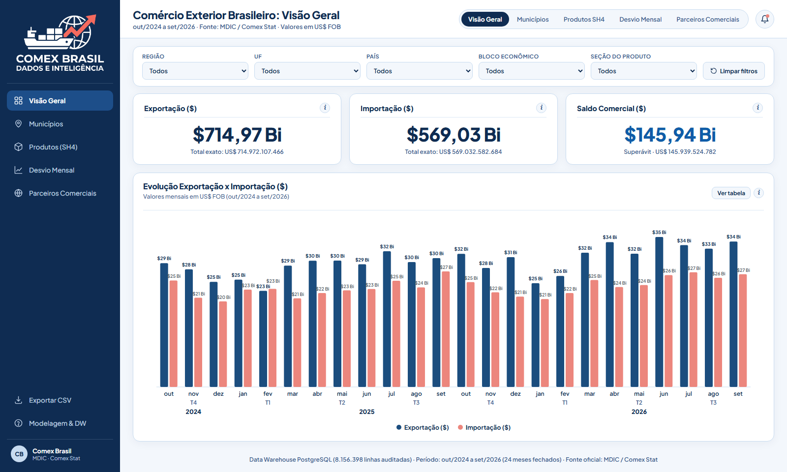
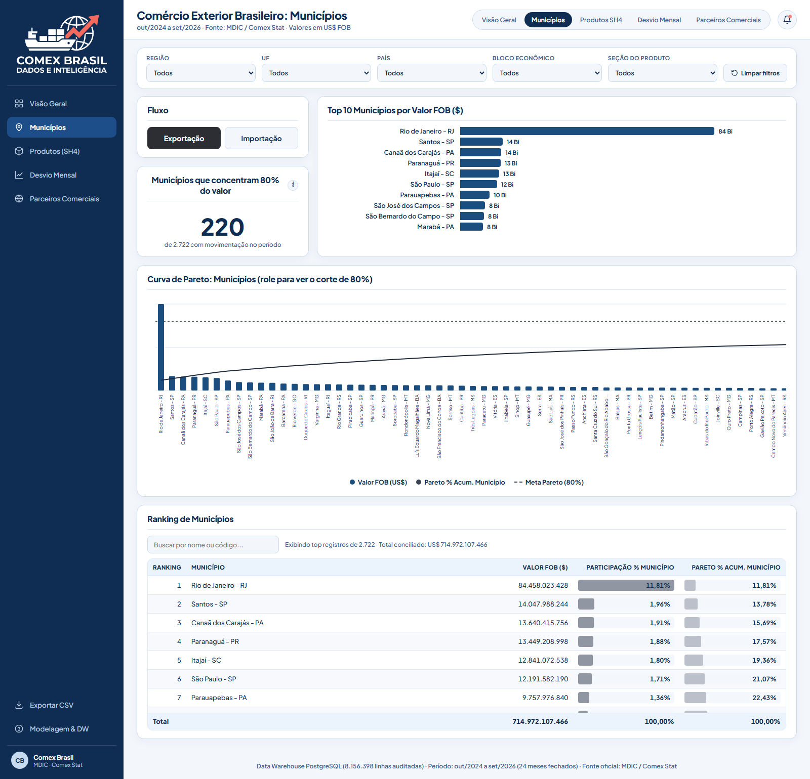
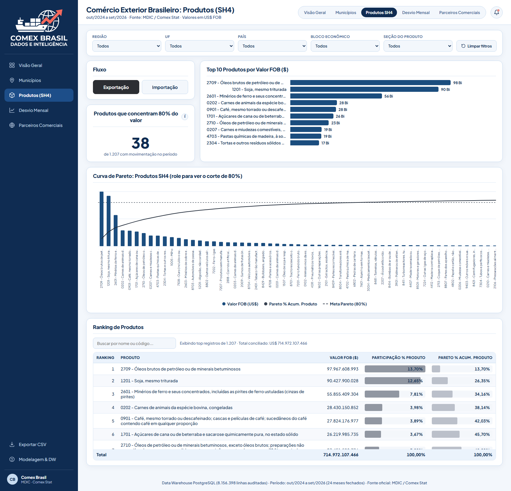
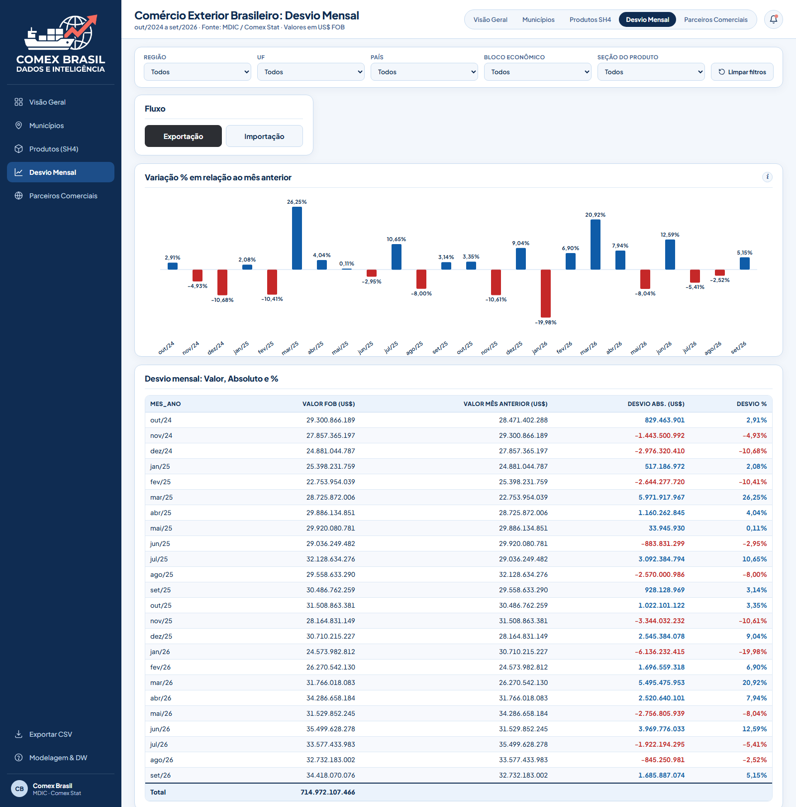
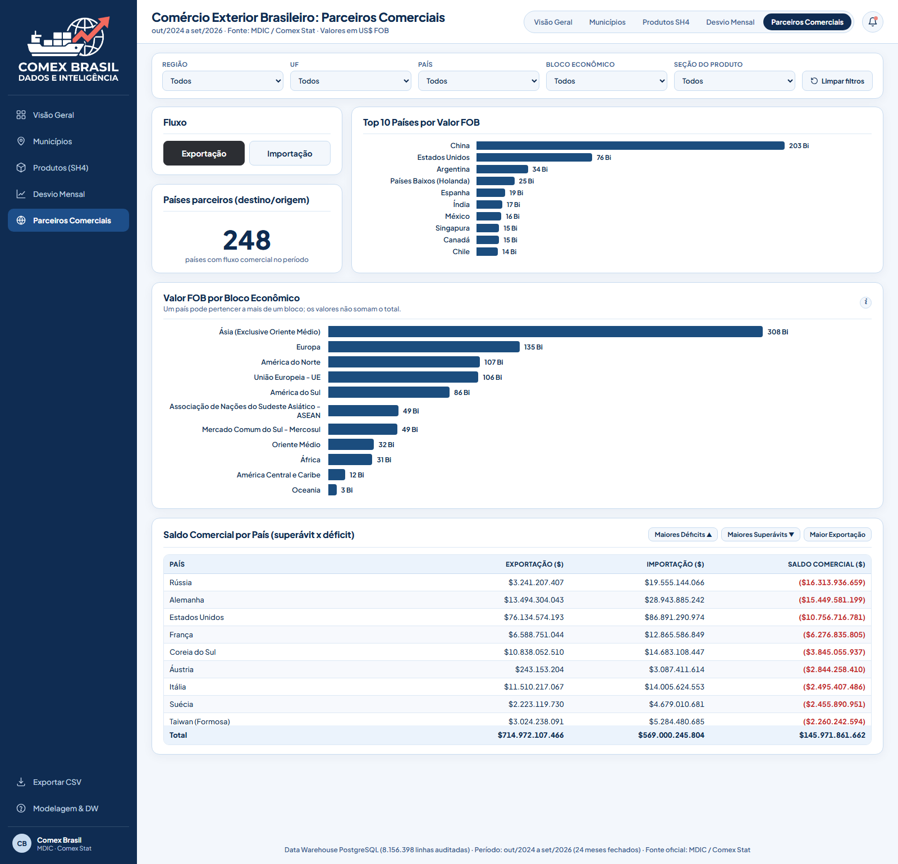
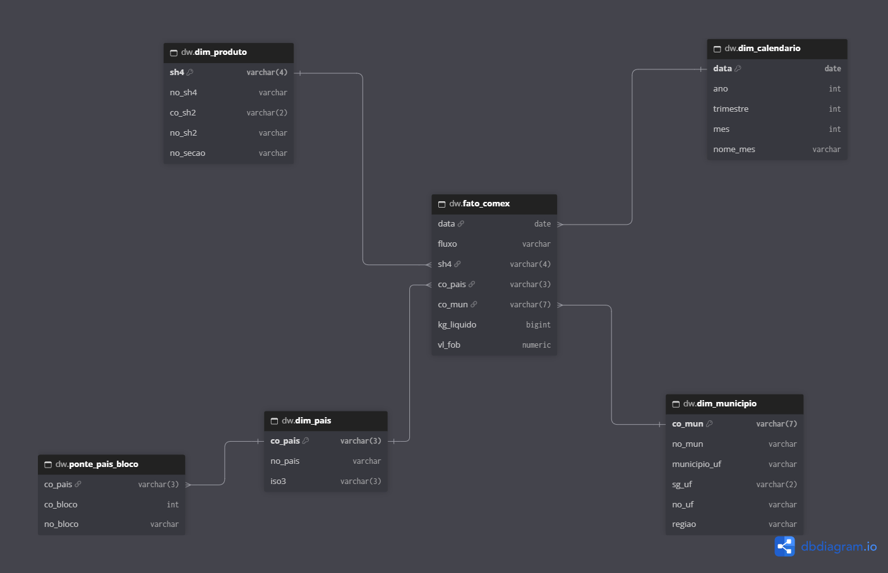

# Comércio Exterior Brasileiro · Comex Brasil (2024 a 2026)

    

Painel analítico de comércio exterior desenvolvido com base nos dados abertos do **Comex Stat (MDIC)**, consolidando exportações e importações brasileiras por município e produto (nível SH4) na série histórica de **outubro de 2024 a setembro de 2026** (os 24 meses fechados mais recentes, totalizando 8.156.398 registros auditados). Valores expressos em US$ FOB.

O projeto une engenharia de dados em PostgreSQL (carga bruta, limpeza via SQL e modelagem dimensional em estrela) e desenvolvimento de dashboards no Power BI e Web App interativo, entregando respostas diretas sobre a balança comercial, concentração municipal, curva de Pareto de mercadorias, sazonalidade mensal e saldos bilaterais com parceiros internacionais.

* **Painel Online (Web App):** [comex-analytics-dw.web.app](https://comex-analytics-dw.web.app)
* **Apresentação Executiva (PDF):** [docs/Apresentacao_Executiva_Comex_Brasil.pdf](docs/Apresentacao_Executiva_Comex_Brasil.pdf)
* **Dashboard HTML Standalone:** [dashboard/Relatorio_Comex_Brasil.html](dashboard/Relatorio_Comex_Brasil.html)
* **Arquivo Power BI (.pbix):** [dashboard/comex_dashboard.pbix](dashboard/comex_dashboard.pbix)
* **Base de Dados Bruta (CSVs):** [Disponível na aba Releases (v1.0)](https://github.com/MihrVMF/comex-analytics-dw/releases/tag/v1.0)

## O problema que o projeto resolve

A base oficial do Comex Stat publica mensalmente arquivos volumosos em formato CSV que somam mais de 8,1 milhões de registros de movimentação comercial, além de tabelas auxiliares com codificações distintas e descrições de mercadorias com aspas sem escape. Consumir esses arquivos diretamente no Power BI sem tratamento prévio degrada a performance do relatório, remove zeros à esquerda de códigos oficiais e duplica valores em cruzamentos de blocos econômicos.

Para resolver esse cenário, estruturei o banco no PostgreSQL em duas camadas: primeiro recebi os 13 arquivos CSV originais no schema `staging` como texto puro; em seguida, construí o schema `dw` em arquitetura Star Schema (tabelas fato e dimensões tipadas em views analíticas, incluindo tabela ponte para blocos econômicos).

## Principais insights encontrados

* **Superávit comercial de US$ 145,94 bilhões:** Nos 24 meses analisados, o Brasil exportou **US$ 714,97 bilhões** e importou **US$ 569,03 bilhões**, mantendo saldo positivo em 23 dos 24 meses da série.
* **Alta concentração na pauta exportadora:** Apenas **38 produtos** na classificação SH4 (de 1.207 com movimentação) respondem por 80% do valor exportado. Óleos brutos de petróleo (US$ 98,0 bi), soja triturada (US$ 90,4 bi) e minérios de ferro (US$ 55,9 bi) somam sozinhos **34,16%** das exportações nacionais.
* **Polos municipais exportadores e importadores:** São necessários **220 municípios** para atingir 80% das exportações. Na importação a concentração é ainda maior, bastando **102 municípios** para cobrir 80% das compras externas (liderados por Itajaí, São Paulo, Manaus e Campinas).
* **Efeito do domicílio fiscal no Rio de Janeiro:** O município do Rio de Janeiro lidera o ranking de exportações com **US$ 84,53 bilhões** (11,82% do país) por sediar grandes petroleiras, já que a base municipal do MDIC contabiliza o domicílio fiscal da empresa exportadora.
* **Assimetria entre China e Estados Unidos:** A China comprou **US$ 202,62 bilhões** (28,34% das exportações brasileiras, quase o triplo dos EUA) e gerou o maior superávit bilateral (**+US$ 55,75 bilhões**). Com os Estados Unidos, segundo maior comprador (US$ 75,38 bi), o Brasil importou US$ 86,15 bi em insumos e bens industriais, fechando com déficit de **-US$ 10,77 bilhões**.
* **Sazonalidade da safra agrícola em março:** As exportações retraem no início do ano (-17,6% em jan/2026) e saltam em março (+26,3% em mar/2025 e +20,9% em mar/2026) com o embarque da safra de soja.

## Telas do Painel

### 1. Visão Geral
Painel executivo com o consolidado de exportações, importações, saldo comercial em US$ FOB e evolução mensal comparativa nos 24 meses.

### 2. Análise por Municípios
Curva de concentração de Pareto (corte de 80%), Top 10 municípios por valor FOB e ranking completo com participação individual e acumulada.

### 3. Produtos (SH4)
Análise por posição do Sistema Harmonizado (SH4), destacando os 38 produtos que concentram 80% da receita de exportação e os 149 produtos que compõem 80% da importação.

### 4. Desvio Mensal
Acompanhamento das oscilações percentuais mês contra mês anterior (MoM %) e tabela analítica detalhada dos 24 meses fechados.

### 5. Parceiros Comerciais
Fluxo bilateral com 248 países parceiros e blocos econômicos, destacando os maiores compradores, fornecedores, superávits e déficits comerciais do Brasil.

## Como os dados foram organizados (Star Schema)

A camada analítica no PostgreSQL foi modelada em esquema estrela (Star Schema) para suportar consultas rápidas sobre os 8,15 milhões de registros da fato e garantir integridade nos filtros cruzados.

* **Camada Staging (`schema staging`):**
  * Recebe os 13 arquivos CSV originais via `COPY` (`staging.exp_mun` com 3.252.883 linhas e `staging.imp_mun` com 4.903.515 linhas) com colunas em texto para tratamento controlado via SQL.
* **Tabela Fato (`dw.fato_comex`):**
  * Unifica exportações e importações via `UNION ALL`, totalizando **8.156.398 linhas** com granularidade mensal por fluxo, código SH4, país e município (`kg_liquido` e `vl_fob`).
* **Tabelas Dimensão e Ponte (`schema dw`):**
  * `dw.dim_municipio`: 5.570 municípios brasileiros com chave SECEX padronizada, UF, região geográfica e tratamento de municípios homônimos no formato `Nome (UF)`.
  * `dw.dim_produto`: 1.274 posições SH4 agregadas a partir do cadastro original em SH6, vinculadas a capítulos (SH2) e seções tarifárias.
  * `dw.dim_pais`: 281 países normalizados com códigos ISO Alpha-3.
  * `dw.ponte_pais_bloco`: tabela ponte que resolve o relacionamento muitos-para-muitos dos **53 países que pertencem a mais de um bloco econômico** (como a Alemanha, presente em Europa e União Europeia), evitando duplicação de valores na tabela fato.
  * `dim_calendario`: calendário contínuo de 24 meses para inteligência temporal (`DATEADD`).

## Desafios Técnicos e Soluções Aplicadas

* **Aspas sem escape no arquivo `NCM_SH.csv`:** O cadastro oficial de produtos continha aspas duplas abertas no meio das descrições de mercadorias, interrompendo o comando `COPY` padrão do PostgreSQL. Carreguei cada linha bruta em uma coluna única na staging e separei os 16 campos no SQL via `split_part` pelo delimitador `;`.
* **Correção de denominador em DAX no cálculo de participação:** Nas páginas de Municípios, Produtos e Parceiros, o uso inicial de `ALLSELECTED` alterava o percentual de participação quando o visual aplicava filtro de Top N. Substituí por `ALL` sobre a dimensão analisada, mantendo o denominador fixo no total dos 24 meses.
* **Higienização de códigos órfãos e encodings mistos:** Tratei a diferença de codificação entre os arquivos de movimento (ASCII) e cadastros auxiliares (Latin-1) e removi 5 códigos de países órfãos na tabela de blocos que não existiam na dimensão mestre de países.

## Validação dos Indicadores (SQL vs Power BI vs MDIC)

Todos os números do banco PostgreSQL, do arquivo Power BI e do Web App foram conciliados contra os arquivos oficiais de conferência do MDIC:

| Fluxo / Indicador | Período | Linhas na Fato | SQL (PostgreSQL) | Power BI / Web App | Status |
|---|---|---:|---:|---:|---|
| **Exportação 2024** | Jan a Dez/2024 | 1.144.828 | US$ 337.046.161.710 | US$ 337.046.161.710 | 100% Conciliado |
| **Exportação 2025** | Jan a Dez/2025 | 1.207.088 | US$ 348.278.462.500 | US$ 348.278.462.500 | 100% Conciliado |
| **Exportação 2026** | Jan a Set/2026 | 900.967 | US$ 284.654.368.793 | US$ 284.654.368.793 | 100% Conciliado |
| **Importação 2024** | Jan a Dez/2024 | 1.729.056 | US$ 262.869.606.174 | US$ 262.869.606.174 | 100% Conciliado |
| **Importação 2025** | Jan a Dez/2025 | 1.798.254 | US$ 280.208.433.825 | US$ 280.208.433.825 | 100% Conciliado |
| **Importação 2026** | Jan a Set/2026 | 1.376.205 | US$ 222.258.509.601 | US$ 222.258.509.601 | 100% Conciliado |
| **Recorte Analítico (24m)** | Out/2024 a Set/2026 | 5.792.418 | Exp: US$ 714.972.107.466 Imp: US$ 569.032.582.684 | Exp: US$ 714.972.107.466 Imp: US$ 569.032.582.684 | Saldo: +US$ 145,94 Bi |

## Tecnologias utilizadas

* **Banco de Dados:** PostgreSQL (schemas `staging` e `dw`, views tipadas e conciliação contábil).
* **Linguagens:** SQL para ingestão, limpeza de strings e modelagem dimensional; DAX para medidas de Pareto, participação fixa e variação mensal (MoM %); HTML5, CSS3 e JavaScript para o Web App standalone.
* **Visualização:** Power BI Desktop (`.pbix`) e Painel Web Interativo.
* **Hospedagem Web:** Firebase Hosting (`.web.app`) para acesso imediato ao painel no navegador.

## Estrutura de Arquivos do Repositório

| Arquivo / Pasta | Conteúdo |
|---|---|
| `sql/01_carga_staging.sql` | Criação do schema `staging` e carga dos 13 arquivos CSV do MDIC |
| `sql/02_dim_municipio.sql` | Construção da view `dw.dim_municipio` com tratamento de UFs e homônimos |
| `sql/03_dim_produto.sql` | Construção da view `dw.dim_produto` agregando NCM no nível SH4 |
| `sql/04_dim_pais_ponte_bloco.sql` | Criação das views `dw.dim_pais` e `dw.ponte_pais_bloco` |
| `sql/05_fato_comex.sql` | Criação da view `dw.fato_comex` unificando exportações e importações |
| `dashboard/Relatorio_Comex_Brasil.html` | Dashboard interativo standalone (abre direto em qualquer navegador) |
| `dashboard/comex_dashboard.pbix` | Arquivo Power BI Desktop com o modelo estrela e as 5 páginas |
| `dashboard/comex_dashboard.pdf` | Exportação visual das telas do painel em PDF |
| `docs/Apresentacao_Executiva_Comex_Brasil.pdf` | Apresentação executiva em slides com os insights de cada página |
| `docs/Documentacao_Dashboard_Comex.pdf` | Documentação técnica completa do projeto |

## Como visualizar ou executar o projeto

1. **Visualização imediata (sem instalar nada):**
   * Acesse o painel interativo online: [comex-analytics-dw.web.app](https://comex-analytics-dw.web.app)
   * Ou abra a apresentação executiva em PDF: [docs/Apresentacao_Executiva_Comex_Brasil.pdf](docs/Apresentacao_Executiva_Comex_Brasil.pdf)

2. **Abrir o painel no Power BI Desktop:**
   * Baixe o arquivo [dashboard/comex_dashboard.pbix](dashboard/comex_dashboard.pbix) e abra diretamente no Power BI Desktop.

3. **Reproduzir o banco de dados no PostgreSQL (opcional):**
   * Crie um banco chamado `comex` no PostgreSQL.
   * Baixe o pacote `COMEX.TABLES.zip` na [aba Releases (v1.0)](https://github.com/MihrVMF/comex-analytics-dw/releases/tag/v1.0) e extraia os CSVs em `C:\comex\dados\`.
   * Execute os scripts da pasta `sql/` em ordem numérica (`01` a `05`).
